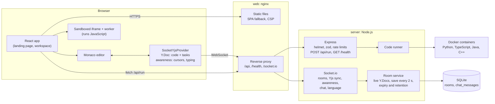

# CollabCode

A real-time collaborative code editor. Create a room, share the link, and edit the same file together with live cursors, chat, a shared task list and a sandboxed code runner. No accounts, no installs.

<!-- Screenshots: add images to docs/screenshots/ and uncomment.


-->

> **Screenshots to add:** home page, a room with two people editing, the phone layout.

## Contents

- [Features](#features)
- [Tech stack](#tech-stack)
- [Design system](#design-system)
- [Architecture](#architecture)
- [Quick start with Docker](#quick-start-with-docker)
- [Local development](#local-development)
- [Scripts](#scripts)
- [Configuration](#configuration)
- [Testing](#testing)
- [Deployment](#deployment)
- [Project structure](#project-structure)
- [Security](#security)
- [Contributing](#contributing)

## Features

**Rooms and sharing**

- One click on the home page creates a room with a readable, hard-to-guess code such as `swift-otter-4821`.
- Share copies an invite link (`/r/<code>`). Anyone who opens it picks a display name and joins; there is no sign-up.
- Join from the home page with a code or a pasted link.
- Up to 10 people per room (configurable). Rooms nobody opens for 30 days are deleted.

**Editing together**

- A Monaco editor (the editor inside VS Code) shared through [Yjs](https://docs.yjs.dev), a CRDT. Simultaneous edits merge, so nobody's typing is overwritten or lost.
- Live cursors and selections with name tags, and "is typing" indicators.
- Undo and redo (Ctrl+Z / Ctrl+Y) only revert your own changes.
- Edits made while offline merge when the connection comes back. If the server ever loses recent changes, reconnecting clients send them back automatically.
- Nine editor languages: JavaScript, TypeScript, Python, Java, C++, JSON, CSS, HTML, Markdown.

**Running code**

- **Run** or Ctrl+Enter (Cmd+Enter on a Mac).
- JavaScript runs in your browser, inside a sandboxed iframe and web worker with a 3-second limit.
- Python, TypeScript, Java and C++ run on the server in a throwaway Docker container: no network, 256 MB memory, 1 CPU, read-only file system, 2-minute limit.

**Around the code**

- Chat that is saved with the room, with timestamps, emoji and retry for messages that failed to send.
- A shared task list you can add to, tick off, edit and delete. It syncs and works offline like the code.
- A People list with cursor colors and typing state.

**Interface**

- Light, dark or system theme, with your choice saved and a cross-fade when it changes.
- A sidebar and output console you can resize by dragging or with the keyboard; their sizes are remembered.
- A terminal-style console with the run command, colored output, errors with their line and column, and the run's duration.
- Remote cursors that show each person's name as a flag above the line, shrinking once they go idle.
- Adjustable font size and keyboard shortcuts (press `?`).
- Toasts for anything that needs attention, skeleton loading screens, and friendly 404 and error pages.
- A short first-visit tour.
- **Responsive:**
  - Phones get a bottom tab bar (Code, Output, Chat, Tasks, People), 44 px touch targets and a symbol bar above the keyboard.
  - Tablets get a drawer sidebar; desktops get a side-by-side sidebar.
- **Accessible:**
  - Labelled controls, keyboard-navigable tabs and dialogs, visible focus, and live regions.
  - Every text and UI color pair is checked against WCAG AA in both themes.

## Tech stack

| Layer       | Technology                                                                                                                     |
| ----------- | ------------------------------------------------------------------------------------------------------------------------------ |
| Client      | React 18, Vite 6, Monaco Editor (bundled, no CDN), Yjs, Socket.io client, lucide-react, Inter and JetBrains Mono (self-hosted) |
| Server      | Node.js 22.13+, Express 4, Socket.io 4, Yjs and y-protocols, zod, helmet, pino                                                 |
| Storage     | SQLite through Node's built-in `node:sqlite`, with migrations                                                                  |
| Code runner | Docker CLI, one locked-down container per run                                                                                  |
| Quality     | ESLint 9 (React, Hooks, jsx-a11y), Prettier, Vitest and Testing Library, Node's test runner, Playwright                        |
| Delivery    | Docker, nginx (unprivileged), Docker Compose, GitHub Actions                                                                   |

## Design system

CollabCode's look is a calm, deep-navy developer tool with one signature gradient (violet → blue → cyan) used sparingly: the logo, primary buttons, the headline accent, active tab indicators and focus glows. Everything else is neutral. Frosted glass appears only on layers that float over content (the start and join cards, modals, menus, toasts). Dark is the hero theme; the light theme has the same structure.

**Where it lives**

- **`client/src/styles/tokens.css`** is the single source for every color, size, shadow and timing. Components use only these variables, never raw values. `[data-theme='light']` on `<html>` swaps every color token.
- **`base.css`** holds fonts, focus rings, selection, scrollbars, textures and reduced motion. **`components.css`** styles the UI kit. **`app.css`** and **`landing.css`** lay out the pages.
- **`client/src/components/ui/`** holds the reusable components.
- **Gallery:** run `npm run dev` and open `/__kit` to see every component and state, plus the 404, invalid-link, join-failure, loading and crash pages. It exists only in development builds.

### Color

| Token                    | Dark      | Light     | Used for                              |
| ------------------------ | --------- | --------- | ------------------------------------- |
| `--color-bg`             | `#080b14` | `#f6f7fb` | Page canvas                           |
| `--color-surface`        | `#0e1220` | `#ffffff` | Panels, top bar, sidebar              |
| `--color-surface-raised` | `#151a2c` | `#ffffff` | Cards, chat bubbles, menus            |
| `--color-surface-sunken` | `#0a0d18` | `#f2f4f9` | Inputs, chips                         |
| `--color-border`         | `#222941` | `#dadfea` | Hairlines                             |
| `--color-border-strong`  | `#5d6784` | `#7a8399` | Input borders (3:1 for UI components) |
| `--color-text`           | `#e9edf7` | `#0e1324` | Body text                             |
| `--color-text-muted`     | `#98a2bc` | `#535c72` | Secondary text                        |
| `--color-accent`         | `#a78bfa` | `#6d28d9` | Focus, selected states                |
| `--color-success`        | `#4ade80` | `#15803d` | Synced, finished runs                 |
| `--color-danger`         | `#fda4af` | `#be123c` | Errors, destructive actions           |
| `--color-warning`        | `#fcd34d` | `#92400e` | Reconnecting                          |
| `--editor-bg`            | `#0b0e1a` | `#fbfcfe` | Code editor and landing mockup        |
| `--console-bg`           | `#070a13` | `#f4f6fb` | Output console                        |

- **Signature gradient** (`--gradient-brand`): `#8b5cf6` → `#3b82f6` → `#22d3ee`, for decoration only.
- **Strong gradient** (`--gradient-brand-strong`): `#7c3aed` → `#2563eb` → `#0e7490`, behind white text such as the primary buttons. Every stop is at least 4.5:1 against white.
- **Participant colors** (`--presence-*`): violet, cyan, amber, rose, lime and sky. Used for avatars, cursors and selections; text on them uses `--color-on-presence`.
- **Syntax colors** (`--syntax-*`) are shared by the landing mockup and the Monaco themes in `client/src/editor/themes.js`. Monaco needs literal colors, so change both together.

`npm run check:contrast` (in `client/`) checks 108 color pairs in both themes against WCAG AA: text, UI borders, every gradient stop with white, syntax colors and the console. It fails if a pair falls short or a theme block is missing. Add a pair there whenever you add a color.

### Type, space, shape and motion

- **Fonts:** Inter for the interface and JetBrains Mono (with ligatures) for code. Both are self-hosted through `@fontsource-variable`, and an Arial fallback sized to Inter's metrics keeps the layout from shifting when the fonts arrive.
- **Type scale:** `--text-2xs` to `--text-lg` are fixed. `--text-xl`, `--text-2xl`, `--text-3xl` and `--text-display` are fluid (`clamp`). Headings use tight tracking (`--tracking-tight`, `--tracking-tighter`) and balanced wrapping.
- **Spacing:** a 4px grid (`--space-1` = 4px through `--space-24` = 96px).
- **Radius:** 6, 8, 10 (controls), 12, 16 (cards and panels) and 20px (modals and hero cards).
- **Depth:**
  - Layered shadows `--shadow-sm`, `--shadow-md` and `--shadow-lg`, plus `--highlight-top`, a faint inner top edge on raised surfaces.
  - `--shadow-glow` and `--shadow-brand` for gradient elements.
  - `--glass-bg`, `--glass-border` and `--glass-blur` for frosted layers.
- **Motion:**
  - 150, 200 and 300 ms with `--ease-out`.
  - Hover lifts, press feedback, sliding tab indicators, modal fade and scale, toast slide in and out, staggered list entrances, and scroll-in cards where the browser supports scroll-driven animation.
  - Switching themes cross-fades the page with the View Transitions API.
  - Pulses animate only transform and opacity, so they never repaint.
  - `prefers-reduced-motion` turns all of it off, and the landing mockup then shows its finished state.

### Components

| Component                                    | Notes                                                                                                                     |
| -------------------------------------------- | ------------------------------------------------------------------------------------------------------------------------- |
| `Button`, `IconButton`                       | `primary` (gradient), `secondary`, `ghost`, `danger`; `sm`, `md`, `lg`; `loading`; `tooltip` and `shortcut` props         |
| `TextField`, `Select`                        | Labels, hints and errors wired to `aria-describedby`; `action` puts a button beside the field; `mono` for codes and links |
| `Tabs`                                       | WAI-ARIA tabs with arrow, Home and End keys and an indicator that slides to the selected tab                              |
| `Modal`                                      | Native `<dialog>` (focus trap, Escape, inert page) with a glass panel and a fade-and-scale entrance                       |
| `Popover`, `Menu`                            | A panel of controls, and a WAI-ARIA menu button with arrows, Home, End, typeahead and checkbox items                      |
| `TooltipLayer`                               | One shared tooltip for any element with `data-tooltip` (and `data-shortcut`): hover or keyboard focus, Escape, hoverable  |
| `Toast` / `useToast`                         | Polite and assertive live regions, pause on hover, slide in and out, shown above open dialogs                             |
| `CopyButton`                                 | Copies, then shows "Copied!" in place without changing width, with a fallback when the clipboard is blocked               |
| `ResizeHandle`                               | WAI-ARIA window splitter: drag, arrow keys, Home, End, double-click to reset                                              |
| `Badge`, `Skeleton`, `EmptyState`, `Spinner` | Status pills, shimmering placeholders, inviting empty panels and the gradient loading ring                                |
| `Avatar`, `AvatarStack`, `Shortcut`          | Initials in participant colors with presence dots, overlapping stacks with "+N", and keyboard keys                        |

## Architecture



**How a join works.** The client sends `join-room` and gets the room's language, participants and recent chat. The server and client then exchange Yjs state vectors and each sends the other what it is missing, which is also how offline edits and edits lost in a crash are recovered. After that, every keystroke is a small Yjs update the server applies and relays. Cursors and typing flags travel as Yjs awareness updates; the server overwrites each person's name and color with its own record, so nobody can pose as someone else.

The full HTTP API, socket events, persistence rules and notes on running several server instances are in [docs/api.md](docs/api.md).

## Quick start with Docker

Requirements: Docker with Compose v2.

```bash
docker compose up --build
```

Open <http://localhost:8080>. Room data lives in the `collabcode-data` volume.

This runs JavaScript in the browser only. To run Python, TypeScript, Java and C++ as well, read the warning in [`docker-compose.runner.yml`](docker-compose.runner.yml) and start with both files:

```bash
docker compose -f docker-compose.yml -f docker-compose.runner.yml up --build
```

## Local development

Requirements:

- Node.js 22.13 or newer and npm 10 or newer.
- Docker Desktop, running, if you want the server to run Python, TypeScript, Java and C++. Without it the output panel says Docker is not running, and everything else works.

Install everything once:

```bash
npm run install:all
```

Start the server and the client in two terminals:

```bash
npm --prefix server run dev
```

```bash
npm --prefix client run dev
```

Open the URL Vite prints (usually <http://localhost:5173>) and create a room. Open the invite link in a second browser window to collaborate with yourself.

## Scripts

| Where  | Command                             | What it does                                                         |
| ------ | ----------------------------------- | -------------------------------------------------------------------- |
| root   | `npm run install:all`               | Installs root, server and client dependencies                        |
| root   | `npm run lint`                      | ESLint over the whole repository (no warnings allowed)               |
| root   | `npm run format` / `format:check`   | Prettier write / check                                               |
| root   | `npm test`                          | Server and client unit and integration tests                         |
| root   | `npm run test:e2e`                  | Playwright end-to-end tests (builds the client, starts both servers) |
| root   | `npm run check`                     | Lint, format check, tests and contrast check, as CI runs them        |
| server | `npm run dev` / `npm start`         | Start with file watching / without                                   |
| server | `npm test`                          | Unit tests plus HTTP and Socket.io integration tests                 |
| client | `npm run dev` / `build` / `preview` | Vite dev server / production build / serve the build                 |
| client | `npm test`                          | Vitest unit and component tests                                      |
| client | `npm run check:contrast`            | WCAG AA contrast check of the design tokens                          |

## Configuration

The server reads environment variables (or `server/.env`; copy [`server/.env.example`](server/.env.example)). Every value is checked at start-up, and a bad value stops the server with a message that names it.

| Variable                                                                                  | Default                              | Meaning                                                                                                               |
| ----------------------------------------------------------------------------------------- | ------------------------------------ | --------------------------------------------------------------------------------------------------------------------- |
| `PORT`                                                                                    | `4000`                               | HTTP and WebSocket port                                                                                               |
| `NODE_ENV`                                                                                | `development`                        | `development`, `production` or `test`                                                                                 |
| `CLIENT_ORIGIN`                                                                           | `http://localhost:5173`              | Comma-separated browser origins allowed to connect. Outside production any `http://localhost:<port>` is also allowed. |
| `TRUST_PROXY`                                                                             | off                                  | Set behind a reverse proxy (`1`, `true` or a subnet list) so rate limits see real client IPs                          |
| `LOG_LEVEL`                                                                               | `info`                               | `fatal`, `error`, `warn`, `info`, `debug`, `trace` or `silent`                                                        |
| `LOG_FORMAT`                                                                              | `pretty` in development, else `json` | Log output format                                                                                                     |
| `DATABASE_PATH`                                                                           | `data/collabcode.db`                 | SQLite file; created on first start                                                                                   |
| `MAX_PARTICIPANTS_PER_ROOM`                                                               | `10`                                 | Join limit per room (1–100)                                                                                           |
| `EMPTY_ROOM_TTL_MINUTES`                                                                  | `30`                                 | How long an empty room stays in memory (it stays in the database)                                                     |
| `ROOM_RETENTION_DAYS`                                                                     | `30`                                 | Stored rooms nobody opens for this long are deleted                                                                   |
| `CODE_RUNNER_ENABLED`                                                                     | `true`                               | `false` turns off the Docker runner                                                                                   |
| `DOCKER_BIN`                                                                              | `docker`                             | Docker CLI to use                                                                                                     |
| `RUNNER_WORK_DIR`                                                                         | OS temp dir                          | Where programs are written before being mounted into a run container                                                  |
| `JAVA_RUNNER_IMAGE`, `CPP_RUNNER_IMAGE`, `PYTHON_RUNNER_IMAGE`, `TYPESCRIPT_RUNNER_IMAGE` | see `.env.example`                   | Runner images, if you need approved or internal ones                                                                  |

The client reads one variable at build time (see [`client/.env.example`](client/.env.example)):

| Variable          | Default                 | Meaning                                                                                                                                       |
| ----------------- | ----------------------- | --------------------------------------------------------------------------------------------------------------------------------------------- |
| `VITE_SERVER_URL` | `http://localhost:4000` | Server address. `same-origin` means "the origin the page was loaded from", for setups where a reverse proxy forwards `/api` and `/socket.io`. |

Docker Compose also reads `PUBLIC_URL` (default `http://localhost:8080`), `WEB_PORT` (default `8080`), `LOG_LEVEL`, `MAX_PARTICIPANTS_PER_ROOM` and `ROOM_RETENTION_DAYS`.

## Testing

| Suite                                          | Command                                  | What it covers                                                                                                                                                                                                                                         |
| ---------------------------------------------- | ---------------------------------------- | ------------------------------------------------------------------------------------------------------------------------------------------------------------------------------------------------------------------------------------------------------ |
| Server unit and integration (Node test runner) | `npm --prefix server test`               | Config, schemas, rate limits, repositories, migrations, room service, awareness filtering, HTTP API, and every socket event against a real server with headless Yjs clients: concurrent edits, offline merges, restarts, size limits, chat, throttling |
| Client unit and component (Vitest)             | `npm --prefix client test`               | Room codes, storage, the Yjs provider, task and presence hooks, tabs, chat, landing page, tasks panel, toasts                                                                                                                                          |
| End-to-end (Playwright)                        | `npm run test:e2e`                       | Two browsers creating, joining, editing, chatting and sharing tasks in one room; running JavaScript; reload persistence; error pages; phone layout and 44 px targets                                                                                   |
| Accessibility colors                           | `npm --prefix client run check:contrast` | 62 color pairs in both themes                                                                                                                                                                                                                          |

Playwright uses your installed Chrome locally. In CI it downloads its own Chromium.

To audit performance and accessibility with Lighthouse:

```bash
npm --prefix client run build
npm --prefix client run preview -- --port 4173
npx lighthouse@13.5.0 http://localhost:4173/ --view
```

The last audit (mobile, throttled) scored 100 for performance, accessibility, best practices and SEO on the home page. Room links score lower for SEO on purpose: `robots.txt` keeps them out of search engines.

## Deployment

The Compose setup is a complete single-machine deployment:

- **`web`**: nginx serves the built app and proxies `/api`, `/health` and `/socket.io` to the server.
  - Unknown paths fall back to `index.html`, so `/r/<code>` links work.
  - Hashed assets are cached for a year, and responses are gzipped.
  - Each page gets a strict Content-Security-Policy with a per-request nonce.
- **`server`**: runs as a non-root user with a health check and a data volume.
  - On `docker compose stop` it saves every room before exiting.

To put it on the internet:

1. **Add TLS.** Terminate HTTPS in front of `web`, for example with Caddy, Traefik or a cloud load balancer. Forward WebSocket upgrades.
2. **Set `PUBLIC_URL`.** Use the address people will open, such as `https://collab.example.com`, so the server accepts their connections.
3. **Back up the `collabcode-data` volume.** It holds the SQLite database. SQLite runs in WAL mode, so back up all three `collabcode.db*` files together, or use `sqlite3 .backup`.
4. **Decide about the code runner.** Enabling it means mounting the Docker socket (see `docker-compose.runner.yml`), so only do that on a dedicated machine.

Deploying without Docker:

- Build the client with `VITE_SERVER_URL` set, and serve `client/dist` with an SPA fallback.
- Run the server with `NODE_ENV=production`, `CLIENT_ORIGIN` and `TRUST_PROXY`.
- Reuse `client/nginx/` as a starting point for the web server config.

Running more than one server instance needs a shared database and shared document updates. See [docs/api.md](docs/api.md#running-more-than-one-server-instance).

## Project structure

```
.
├── client/                 React app (Vite)
│   ├── src/
│   │   ├── collab/         Yjs provider, Monaco binding, remote cursors
│   │   ├── components/     Screens and panels; ui/ holds the design-system components
│   │   ├── dev/            The /__kit gallery (development builds only)
│   │   ├── editor/         Bundled Monaco setup and the CollabCode editor themes
│   │   ├── hooks/          Room session, collaboration, preferences, media queries
│   │   ├── lib/            Room codes, clipboard, storage, server URL, platform helpers
│   │   └── styles/         tokens.css, base.css, components.css, app.css, landing.css
│   ├── nginx/              Production web server config (CSP, proxy, caching)
│   └── scripts/            check-contrast.mjs
├── server/
│   ├── src/
│   │   ├── config/         Validated environment config, limits, origins
│   │   ├── controllers/    HTTP handlers
│   │   ├── db/             SQLite connection and migrations
│   │   ├── middleware/     Errors, rate limiting, body validation
│   │   ├── models/         SQL for rooms and chat
│   │   ├── routes/         HTTP routes
│   │   ├── services/       Room service, awareness filter, code runner
│   │   ├── socket/         Socket.io handlers (rooms, Yjs, chat, language, limits)
│   │   └── validation/     zod schemas for every payload
│   └── test/               Node test runner suites
├── e2e/                    Playwright tests
├── docs/api.md             HTTP API, socket events, persistence, scaling
├── docker-compose.yml      Production-style local deployment
└── .github/workflows/ci.yml
```

## Security

- **Input validation.** Every HTTP body and socket payload is validated with zod. Unknown fields are dropped, and display names and chat cannot contain control or bidi-override characters.
- **Rate limits and identity.**
  - Rate limits apply to `/api`, code runs, socket events (count and bytes) and chat.
  - WebSocket connections from foreign origins are refused.
  - Cursor names and colors come from the server.
- **Headers.** helmet on the API, and a nonce-based CSP, `nosniff`, no referrer and `frame-ancestors 'none'` on the web app.
- **Code runs.**
  - Native runs use a locked-down container per run.
  - JavaScript runs in a sandboxed iframe with no access to the app.
- **Rooms.** Rooms are public to anyone with the link; there are no accounts. Treat invite links like passwords.

## Contributing

Run `npm run check` before opening a pull request; CI runs the same checks plus the end-to-end tests and a Docker build. The repository has no license file yet.
